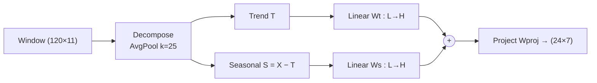

# Weather Forecasting — DLinear

Lightweight linear decomposition forecaster (seasonal/trend split + linear
projection) for the 5-model group comparison. Produces the shared
**24 h × 7-variable** forecast on the real scale, rolled over the 2025 test year.
Two variants are trained: **DLinear-S** (shared weights) and **DLinear-I**
(individual per-channel weights); the report uses **DLinear-I**.

- **Input:** `(120, 11)` window — 7 weather targets + 4 cyclical time encodings
  (5-day lookback).
- **Targets (7):** `temp, rh, dew, pressure, cloud, wx, wy` → output `(24, 7)`.
- **Split (chronological):** train 2021–2023, val 2024, test 2025.
- **Training:** MSE + Adam, `ReduceLROnPlateau`, early stopping on val loss, 3 seeds
  `{42, 123, 456}`; the reported forecast is the seed-ensemble mean.

## Background

DLinear is a deliberately minimal forecaster: it **decomposes** each input series
into a slow trend (a moving average) and a seasonal/remainder component, then maps
each component from the 120 h lookback to the 24 h horizon with a *single linear
layer*, and sums them. Despite having no nonlinearity and <6k parameters, this
decomposition makes it a strong, extremely cheap baseline. Two variants:
**DLinear-S** shares one projection across channels; **DLinear-I** gives each
channel its own (used in the report).

## Formula

**Decomposition** — a length-preserving moving average (kernel $k=25\approx$ one
day, replication-padded) extracts the trend; the remainder is the seasonal part:

$$\mathbf{T} = \text{AvgPool1d}(\mathbf{X}_{\text{padded}},\,k{=}25),\qquad \mathbf{S} = \mathbf{X} - \mathbf{T}.$$

**Dual linear projection** ($L=120 \to H=24$), then combine and project to the 7
outputs:

$$\hat{\mathbf{Y}}_t = \mathbf{W}_t\mathbf{T}+\mathbf{b}_t,\quad \hat{\mathbf{Y}}_s = \mathbf{W}_s\mathbf{S}+\mathbf{b}_s,\qquad \hat{\mathbf{Y}} = (\hat{\mathbf{Y}}_t+\hat{\mathbf{Y}}_s)\,\mathbf{W}_{\text{proj}}\in\mathbb{R}^{H\times C_{\text{out}}}$$

with $\mathbf{W}_t,\mathbf{W}_s\in\mathbb{R}^{H\times L}$. DLinear-I uses a separate
$(\mathbf{W}_t^{(c)},\mathbf{W}_s^{(c)})$ per channel.

## Architecture



## Dependencies

Python **3.12** (tested on 3.12.4). CPU is sufficient (the model is tiny, <6k
params); CUDA is used automatically if available.

```bash
pip install -r DLinear/requirements.txt
# or:
pip install "torch>=2.0" "numpy>=1.24" "pandas>=2.0" "scikit-learn>=1.2" "matplotlib>=3.7" "seaborn>=0.12"
```

## Data

Expects the shared hourly dataset at the **repository root**:
`../weather_dataset.csv` (i.e. `D:/WeatherForecast/weather_dataset.csv`). If only
`data/weather_dataset.csv` exists, copy it up once:

```bash
cp data/weather_dataset.csv weather_dataset.csv
```

## Run (three steps, from the `DLinear/` folder)

```bash
cd DLinear
python src/prepare_data.py     # -> outputs/processed_data.npz, scaler.pkl
python src/train.py            # trains DLinear-S and DLinear-I, 3 seeds each -> checkpoints*/
python src/evaluate.py         # metrics, plots, and forecasts_eval.npz
```

`train.py` finishes in a few minutes on CPU. `evaluate.py` loads the saved
checkpoints (no retraining). A harmless error at the very end of `evaluate.py`
(a single-seed diagnostics helper looking for `best_model.pth`) does **not** affect
the metrics or the forecast dump, which are written first.

## Reproduce the reported results

Check `outputs/I/evaluation_results.json` (`overall`). Expected DLinear-I on the
2025 test year (real scale):

| Metric | Value |
|--------|-------|
| Overall MAE  | **5.64** |
| Overall RMSE | **12.19** |

Per-variable MAE (DLinear-I): temp 1.18, rh 5.64, dew 1.19, pressure 1.13,
cloud 23.00, wx 4.39, wy 3.07. Across-seed std is small (≤±0.03, cloud ±0.11).

## Outputs

```
DLinear/
  outputs/
    processed_data.npz       windowed train/val/test arrays + scaler
    S/ , I/                  per-variant: evaluation_results.json, test_metrics.csv, plots
    forecasts_eval.npz       DLinear-I seed-ensemble per-origin forecasts
                             — consumed by ../analysis/significance.py (DM/MCS tests)
  checkpoints/ , checkpoints_i/   best_model_seed{42,123,456}.pth (S and I)
```

## Key config (`src/config.py`)

`LOOKBACK=120`, `FORECAST=24`, `KERNEL_SIZE=25`, `BATCH_SIZE=64`,
`LEARNING_RATE=1e-3`, `EPOCHS=50`, `PATIENCE=10`, `WEIGHT_DECAY=1e-5`, seeds
`{42, 123, 456}`.
