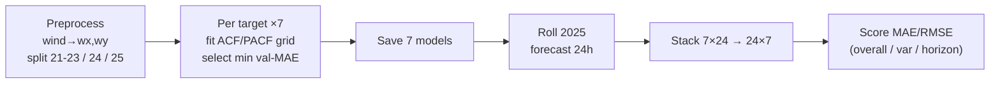

# Per-Feature ARIMA-Family Weather Baseline

Each of the 7 targets (`temp, rh, dew, pressure, cloud, wx, wy`) gets its **own
candidate grid** and is fit by an independent univariate model whose family is
chosen **per variable** by rolling-origin validation MAE. The grid for each
variable spans the whole ARIMA family:

```
AR  ·  MA  ·  ARMA  ·  ARIMA  ·  SARIMA
```

Nothing is forced to be seasonal and nothing is forced to a fixed `(2,0,1)`.
A variable with a weak daily cycle (e.g. `cloud`, `wy`) is free to select a
**non-seasonal** model; a very persistent one (e.g. `temp`, `pressure`) can
select a higher-order AR with a seasonal term.

## Background

SARIMA (Seasonal ARIMA) models a single series with autoregressive,
differencing, and moving-average operators at both ordinary and seasonal lags. It
is the seasonal member of the broader **ARIMA family** (AR · MA · ARMA · ARIMA ·
SARMA · SARIMA). Here the 24 h × 7 forecast is produced by **seven independent
univariate models**, one per target — but, unlike a one-size-fits-all baseline,
each target searches *its own* candidate grid (bounded by its own ACF/PACF
signature) and keeps whichever family member minimises validation MAE. It is the
classical univariate reference: a transparent, assumption-driven lower bound that
isolates how much accuracy comes from cross-variable structure (VAR) or
nonlinearity (XGBoost, LSTM). On this data every target selects a seasonal ARMA
(`SARMA`, $d=D=0$) with daily period $s=24$.

## Formula

A $\text{SARIMA}(p,d,q)(P,D,Q)_s$ model, with backshift operator $B$ and
white noise $\varepsilon_t$:

$$\Phi_P(B^{s})\,\phi_p(B)\,(1-B)^d(1-B^{s})^{D}\,y_t = c + \Theta_Q(B^{s})\,\theta_q(B)\,\varepsilon_t$$

where $\phi_p,\theta_q$ are the non-seasonal AR/MA polynomials and
$\Phi_P,\Theta_Q$ their seasonal counterparts. Each ARIMA-family member is a
special case (e.g. AR: $q=0$, no seasonal; SARMA: $d=D=0$, $P,Q>0$). Orders are
identified by Box–Jenkins ($d,D$ from ADF/KPSS; $p,q$ from PACF/ACF cutoffs;
$P,Q$ from spikes at lag 24) and the winner is picked by validation MAE.

## Architecture



## Dependencies

Python **3.12** (tested on 3.12.4). CPU only.

```bash
pip install -r SARIMA-ARIMA-AR-MA/requirements.txt
# or:
pip install "numpy>=1.24" "pandas>=2.0" "statsmodels>=0.14" "matplotlib>=3.7" "joblib>=1.3"
```

`joblib` is optional and only needed for `--jobs > 1`.

## Data

Expects the shared hourly dataset at **`../data/weather_dataset.csv`** (repo-root
`data/` folder); override with `--data <path>`. Loading, wind decomposition and the
protocol split are handled in `data_prep.py`.

## Why per-feature grids

The earlier shared-grid pipeline (`weather-sarima/`) applied **one** candidate
set to all 7 variables and let each pick its winner. That works but wastes time
fitting implausible orders on every variable. Here each variable searches only
the orders justified by **its own ACF/PACF** signature (measured on the
2021-2023 train split), so the search is smaller, faster, and better targeted.

See `config.py` → `PER_FEATURE_GRID` for the candidate set per variable and the
one-line rationale above each block.

## Key design choices

- **`d = D = 0`** everywhere. ADF + KPSS agree the targets are level-stationary;
  the annual cycle is *deterministic*, not a unit root, so no differencing.
- **Seasonal period `s = 24`** (daily) only. Annual seasonality is **not** a
  second SARIMA period — `s ≈ 8766` is infeasible for `SARIMAX` and the annual
  cycle is deterministic. It would enter, if at all, as exogenous Fourier terms
  (out of scope for this baseline; the ML/DL models carry the day-of-year
  encodings instead).
- **`pressure`** uses `enforce_stationarity/invertibility = True`
  (`PER_FEATURE_OPTIONS`) because it was convergence-fussy with free roots.
- **Selection metric:** rolling-origin validation MAE on 2024, AIC breaks ties.
- **Evaluation:** rolling 24 h forecasts over 2025, MAE/RMSE overall /
  per-horizon / per-variable, plus a bootstrap 95% CI on the overall metrics.

## Layout

```
config.py        constants + PER_FEATURE_GRID + per-feature fit options
data_prep.py     load + protocol split (wind decomposition, 2021-23/24/25)
models.py        SARIMAX fit, family naming, per-feature selection, save/load
diagnostics.py   ADF (pre-fit), Ljung-Box + Jarque-Bera (post-fit)
evaluate.py      rolling-origin forecast, metrics, bootstrap CI
plots.py         per-horizon / per-variable / predicted-vs-actual plots
run.py           end-to-end entry point
```

## Run

```powershell
# Full run (serial). Writes everything under results/.
python SARIMA-ARIMA-AR-MA/run.py

# Parallel across the 7 features (needs joblib). Each worker holds one SARIMAX
# fit in memory, so cap jobs on memory-limited machines.
python SARIMA-ARIMA-AR-MA/run.py --jobs 3

# Quick smoke test: 5 rolling origins, no plots, no bootstrap.
python SARIMA-ARIMA-AR-MA/run.py --max-origins 5 --no-plots --bootstrap 0

# Use all pre-test data (2021-2024) for the final fit.
python SARIMA-ARIMA-AR-MA/run.py --fit-through-val

# Check data loading and splits without fitting.
python SARIMA-ARIMA-AR-MA/run.py --dry-run
```

The default data path is `../data/weather_dataset.csv`; override with `--data`.

## Reproduce the reported results

A full run (`python SARIMA-ARIMA-AR-MA/run.py`) writes `results/overall_metrics.csv`.
Expected on the 2025 test year (real scale):

| Metric | Value |
|--------|-------|
| Overall MAE  | **6.04** (95% bootstrap CI [5.84, 6.26]) |
| Overall RMSE | **12.63** (95% bootstrap CI [12.12, 13.17]) |

Per-variable MAE: temp 1.35, rh 6.14, dew 1.20, pressure 1.24, cloud 24.45,
wx 4.63, wy 3.29. Every target selects a seasonal ARMA model (`models/best_models.csv`).
The run also writes `results/forecasts.csv` (per-origin `y_true`/`y_pred` with
`target_time`), consumed by `../analysis/significance.py` for the cross-model
Diebold–Mariano / Model Confidence Set tests.

## Outputs (`results/`)

```
diagnostics.txt              selected model per feature + ADF/LB/JB tables
overall_metrics.csv          overall MAE/RMSE (+ bootstrap CI columns)
per_horizon_metrics.csv      error vs lead time (h = 1..24)
per_variable_metrics.csv     error per target
metrics.csv                  all of the above, long format
forecasts.csv                every (origin, horizon, variable) prediction
models/best_models.csv       the chosen family/order per feature
models/model_selection.csv   every candidate's validation score (the evidence)
models/<var>.pkl             saved fitted model per feature
plots/                       per-horizon, per-variable, predicted-vs-actual
```

`models/model_selection.csv` is the receipt: it shows every candidate that was
tried per variable and why the winner won, so the per-feature choice is
reproducible rather than asserted.

## Tuning the grids

Edit `PER_FEATURE_GRID` in `config.py`. Add `(order, seasonal_order)` tuples to
a variable's list; use `(0, 0, 0, 0)` as the seasonal order to offer a fully
non-seasonal candidate. Re-run; each variable re-selects from its updated grid.
