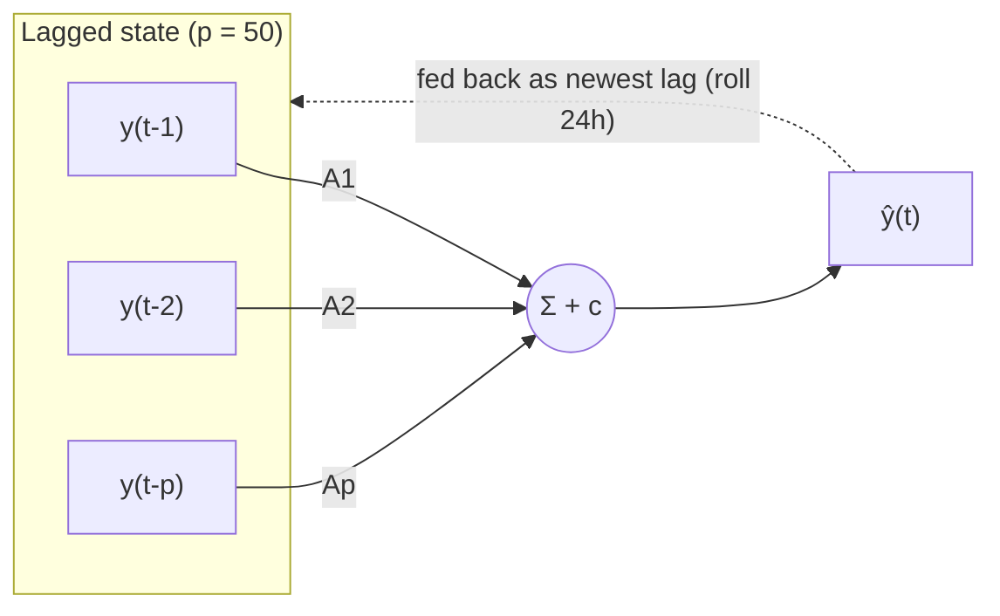

# Weather Forecasting — Vector Autoregression (VAR)

Multivariate statistical baseline for the 5-model group comparison. A single
VAR$(p)$ is fit on the seven targets jointly and rolled over the 2025 test year to
produce the shared **24 h × 7-variable** forecast on the real scale.

- **Targets (7):** `temp, rh, dew, pressure, cloud, wx, wy`
- **Split (chronological, never shuffled):** train 2021–2023, val 2024 (kept for
  group parity; VAR does not use it), test 2025.
- **Model:** lag order chosen by AIC (`MAXLAGS=60`; settles at $p=50$), fit by OLS,
  differencing order confirmed by ADF at runtime, rolling 24 h non-overlapping
  origins.

## Background

Vector Autoregression models the seven targets **jointly**: every variable is
regressed on its own past values *and* the past values of all the others, so the
linear cross-dependencies in the data (the strong `temp`–`dew`–`pressure`–`rh`
coupling) are captured directly. It is the multivariate counterpart to a
univariate ARIMA/SARIMA, fully interpretable (each coefficient is one variable's
linear effect on another), and deterministic to fit (ordinary least squares — no
seeds, no tuning). We include it to measure how much accuracy comes purely from
modelling cross-variable structure, with no nonlinearity.

## Formula

For a $k$-dimensional observation $\mathbf{y}_t$ ($k=7$) and lag order $p$, the
VAR($p$) process is

$$\mathbf{y}_t = \mathbf{c} + \sum_{i=1}^{p}\mathbf{A}_i\,\mathbf{y}_{t-i} + \boldsymbol{\varepsilon}_t,\qquad \boldsymbol{\varepsilon}_t\sim(\mathbf{0},\boldsymbol{\Sigma})$$

with intercept $\mathbf{c}\in\mathbb{R}^{7}$, coefficient matrices
$\mathbf{A}_i\in\mathbb{R}^{7\times7}$, and white-noise innovations of covariance
$\boldsymbol{\Sigma}$. The lag order is chosen by AIC (here $p=50$). Forecasting
rolls forward: the predicted $\hat{\mathbf{y}}_t$ is fed back as the newest lag to
produce $\hat{\mathbf{y}}_{t+1}$, and so on across the 24-hour horizon.

## Architecture



Pipeline: preprocess → ADF stationarity / differencing → AIC lag selection → OLS
fit on 2021–2023 → rolling-origin forecast over 2025 → invert to real scale →
score.

## Dependencies

Python **3.12** (tested on 3.12.4). Install:

```bash
pip install -r weather-var/requirements.txt
# or:
pip install "numpy>=1.24" "pandas>=2.0" "statsmodels>=0.14" "scikit-learn>=1.2" "matplotlib>=3.7"
```

## Data

Expects the shared hourly dataset at **`../data/weather_dataset.csv`** (repo-root
`data/` folder, git-tracked). No manual preprocessing is needed — loading, cleaning,
wind decomposition (`wx, wy`) and the split are done in `src/data_prep.py`.

## Run

```bash
python weather-var/src/run.py
```

Runs end-to-end: prep → ADF stationarity/differencing → AIC lag selection → fit →
diagnostics → rolling-origin evaluation → write results. Deterministic (no seed
needed; the bootstrap interval uses a fixed seed).

## Reproduce the reported results

After running, check `results/metrics.csv` (row `scope=overall`). Expected on the
2025 test year (real scale):

| Metric | Value |
|--------|-------|
| Overall MAE  | **5.57** |
| Overall RMSE | **12.07** |

Per-variable MAE: temp 1.11, rh 5.60, dew 1.10, pressure 1.10, cloud 22.82,
wx 4.22, wy 3.05.

## Outputs (`weather-var/results/`)

```
metrics.csv          overall / per-horizon / per-variable MAE & RMSE
diagnostics.csv      per-variable ADF / Ljung-Box / Jarque-Bera table
diagnostics.txt      human-readable diagnostics report
run_log.txt          full run log
forecasts_eval.npz   per-origin forecasts (y_true, y_pred, targets, origin_time)
                     — consumed by ../analysis/significance.py (DM/MCS tests)
plots/               pred-vs-actual, per-horizon error, forecast-interval bands
```

## Layout

```
weather-var/
  src/
    config.py       paths, split years, HORIZON=24, MAXLAGS=60, ROLL_STEP=24
    data_prep.py    load, clean, wind decomposition, chronological split
    var_model.py    ADF, differencing, AIC lag selection, OLS fit, stability
    diagnostics.py  Ljung-Box / Jarque-Bera on residuals
    evaluate.py     rolling-origin forecast, metrics, bootstrap CI, npz dump
    run.py          end-to-end entry point
  results/          written by run.py
```
