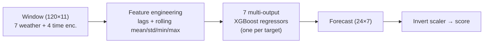

# Weather Forecasting — XGBoost

XGBoost member of the group comparison defined in [`../PROTOCOL.md`](../PROTOCOL.md).
Same data handling, split, horizon and metrics as the VAR / DL models so results
are directly comparable.

## What it does

Produces the shared artifact: a **24 h × 7-variable** forecast on the real scale,
evaluated by rolling 24 h origins over the 2025 test year.

- **Input** `(120, 11)` — 7 weather features (the 7 targets) + 4 cyclical time
  encodings. **Deviation from §2:** the protocol specifies 8 weather features
  (12 total); by project decision `precip` is dropped, giving 11. Agree the
  shared input set across the group for a fair comparison.
- **Targets (7)** `temp, rh, dew, pressure, cloud, wx, wy` → output `(24, 7)`.
- **Model** — XGBoost is tabular, so the `(120, 11)` window is encoded into
  compact engineered features (recent lags + rolling mean/std/min/max per
  channel) and **7 multi-output regressors** (one per target) each predict that
  variable's 24 horizons. Every feature is a function of the 120 h history up to
  the origin only — same information and no-leakage horizon as the raw window.
- **Split** chronological: train 2021–2023, val 2024, test 2025. Never shuffled.
- **Scaling** `StandardScaler` fit on **train only**; forecasts denormalised before
  scoring. Cyclical time encodings are left in `[-1, 1]`.
- **Early stopping** on 2024 val windows; the 2025 test set is untouched during
  training.
- **Determinism** seeds `[0, 1, 2]`; metrics reported for the seed-ensemble plus a
  per-seed std.

## Layout (mirrors the VAR reference, §10)

```
weather-xgb/
  run.py                  # orchestrator
  src/
    config.py             # paths, features, split, window & XGB params, seeds
    data_prep.py          # load, clean, wind decomp, time encodings, split, scale, windows
    xgb_model.py          # 7 multi-output regressors, early stopping, save
    diagnostics.py        # §6 ML/DL analogues (convergence, Ljung-Box, normality, intervals)
    evaluate.py           # §7 rolling-origin metrics, bootstrap CIs, plots
  results/
    metrics.csv           # overall / per-horizon / per-variable MAE & RMSE (+ CIs)
    diagnostics.txt        # §6 diagnostics report
    plots/                # learning curves, residuals, per-horizon, pred-vs-actual
  models/                 # saved boosters + training history per seed
```

## Background

XGBoost is a gradient-boosted ensemble of regression trees. It is *tabular*, so
the `(120, 11)` lookback window is first encoded into compact engineered features
(recent lags + rolling mean/std/min/max per channel), and **seven multi-output
regressors** — one per target — each predict that variable's 24 horizons. Trees
capture nonlinear interactions and thresholds (e.g. cloud's near-bimodal
behaviour) that the linear models cannot, while staying cheap to train on CPU. It
is the strongest all-round value baseline in the comparison.

## Formula

Gradient boosting builds an additive model of $K$ trees,

$$\hat{y}_i = \sum_{k=1}^{K} f_k(\mathbf{x}_i),\qquad f_k \in \mathcal{F}\ \text{(regression trees)},$$

trained on the regularised objective

$$\mathcal{L} = \sum_i \ell(y_i,\hat{y}_i) + \sum_k \Omega(f_k),\qquad \Omega(f) = \gamma T + \tfrac{1}{2}\lambda\lVert\mathbf{w}\rVert^2 .$$

A second-order Taylor expansion at round $t$ (gradients $g_i,h_i$) gives the
optimal leaf weight and split score

$$w_j^{\star} = -\frac{\sum_{i\in I_j} g_i}{\sum_{i\in I_j} h_i + \lambda},\qquad \tilde{\mathcal{L}} = -\tfrac{1}{2}\sum_{j=1}^{T}\frac{\left(\sum_{i\in I_j} g_i\right)^2}{\sum_{i\in I_j} h_i + \lambda} + \gamma T .$$

With squared-error loss, $g_i=\hat{y}_i-y_i$ and $h_i=1$.

## Architecture



## Dependencies

Python **3.12** (tested on 3.12.4). CPU only.

```bash
pip install -r weather-xgb/requirements.txt
# or:
pip install "xgboost>=2.0" "numpy>=1.24" "pandas>=2.0" "scikit-learn>=1.2" "scipy>=1.10" "matplotlib>=3.7"
```

## Data

Expects the shared hourly dataset at the **repository root**:
`weather_dataset.csv` (i.e. `D:/WeatherForecast/weather_dataset.csv`). If only
`data/weather_dataset.csv` exists, copy it up once:

```bash
cp data/weather_dataset.csv weather_dataset.csv
```

## Run

```bash
python weather-xgb/run.py            # full: 3 seeds, dense train windows
python weather-xgb/run.py --smoke    # fast validation (1 seed, small model)
```

## Reproduce the reported results

After a full run, check `results/metrics.csv` (row `scope=overall`). Expected on
the 2025 test year (real scale, 3-seed ensemble):

| Metric | Value |
|--------|-------|
| Overall MAE  | **5.48** (95% CI [5.27, 5.68], seed std ±0.008) |
| Overall RMSE | **11.93** (95% CI [11.43, 12.39], seed std ±0.015) |

Per-variable MAE: temp 1.06, rh 5.43, dew 1.08, pressure 1.24, cloud 22.42,
wx 4.15, wy 2.99. The run also writes `results/forecasts_eval.npz` (per-origin
`y_true`/`y_pred`/`origin_time`) consumed by `../analysis/significance.py` for the
cross-model Diebold–Mariano / Model Confidence Set tests.

## Diagnostics

| Protocol method      | XGBoost analogue implemented |
|----------------------|------------------------------|
| Stability            | val-RMSE learning curves converge, no divergence |
| Ljung-Box (lag 24)   | autocorrelation of 1-step val-forecast residuals, per variable |
| Residual normality   | D'Agostino K² test + histogram / Q-Q plots |
| Forecast intervals   | empirical residual bands that widen with the horizon (+ coverage) |
| Bootstrap CI         | resample test origins → 95% CI on overall MAE/RMSE |

## Metrics

`results/metrics.csv` holds **overall**, **per-horizon (1…24)** and **per-variable**
MAE & RMSE. Overall MAE/RMSE additionally carry a bootstrap 95% CI and a multi-seed std.
